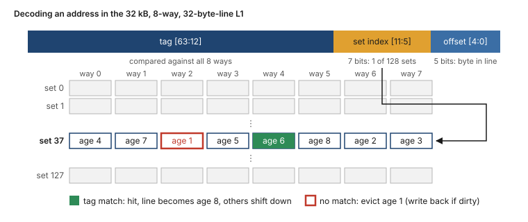
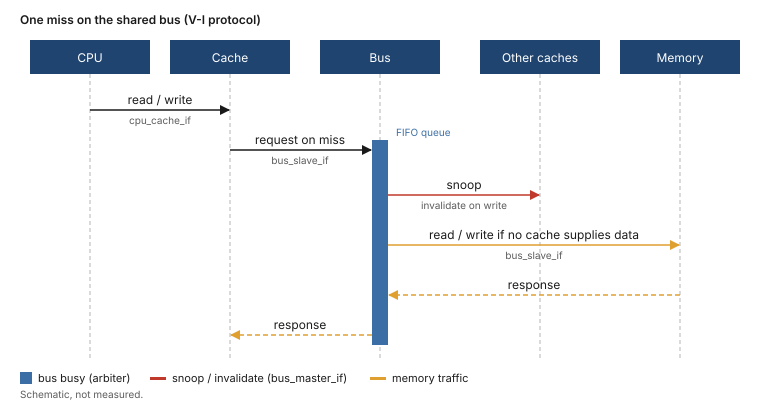
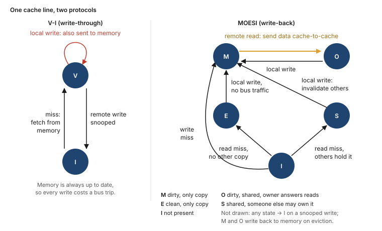
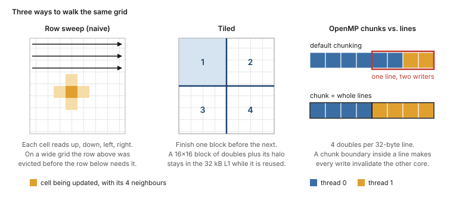

# Parallel Cache Simulator

A trace-driven L1 data cache and coherence simulator written in C++ and SystemC. It models a single-core cache, a shared-bus multicore system with Valid–Invalid (V-I) coherence, and a multicore system with MOESI coherence. An OpenMP heat-diffusion case study examines how traversal order and thread scheduling affect cache traffic.

[Simulating a Cache with SystemC](https://0chonko.github.io/blog/simulating-a-cache-with-systemc/) covers the design, diagrams, and benchmark results.

## Simulator stages

| Target | Model |
| --- | --- |
| `assignment_1` | Single-core L1 data cache with write-back, write-allocate, and LRU replacement |
| `assignment_1_tlm` | Single-core implementation with transaction-level interfaces |
| `assignment_2` | Multicore caches on a shared bus using write-through V-I coherence |
| `assignment_3` | Multicore MOESI with cache-to-cache transfers and write-back of dirty lines |

The baseline cache is 32 KiB, with 32-byte lines and eight ways. Its 1,024 lines form 128 sets, so the address uses five offset bits and seven set-index bits. The multicore models also have 64, 128, and 512 KiB build targets.



The shared bus uses a FIFO queue to arbitrate requests. Under V-I, stores go to memory and invalidate matching copies in peer caches. MOESI lets a cache supply dirty data directly to another core. For example, a read of a Modified line can move the original copy to Owned and give the requester a Shared copy. A local write to an Exclusive line moves it to Modified without a bus transaction.





## Build and run

With GNU Make, a C++14-capable compiler, and a compatible SystemC installation, run from the repository root:

```sh
make targets
make -B assignment_2 assignment_3 SYSTEMC_PATH=/path/to/systemc SYSTEMC_LIBDIR=/path/to/systemc/lib
./assignment_2.bin tracefiles/matrix_mult_50_50_p4.trf
./assignment_3.bin tracefiles/matrix_mult_50_50_p4.trf
```

Set `SYSTEMC_LIBDIR` to the directory containing the SystemC library. The example forces a rebuild because the repository includes prebuilt binaries. The trace determines the simulated core count. The bundled matrix traces include 1-, 2-, 4-, and 8-core variants.

- [`src/`](src/) contains the simulator implementations.
- [`lib/`](lib/) contains the shared trace reader and statistics code.
- [`tracefiles/`](tracefiles/) contains workloads and protocol test traces.
- [`experiments/`](experiments/) contains recorded V-I and MOESI runs by cache size.

## Reported results

- **Single-core cache.** The portfolio reports a 96.42% hit rate for a 50×50 matrix workload and 97.91% for FFT at 32 KiB. The 8×5000 workload fell from 96.77% at 32 KiB to 88.86% at 128 KiB, then recovered to 97.73% at 512 KiB. The article attributes the dip to conflict misses from set indexing.
- **Multicore coherence.** MOESI sustained hit rates above 80% in the reported comparisons and reduced memory accesses through cache-to-cache transfers. Average bus acquisition time improved slightly.
- **OpenMP heat diffusion.** The case study compared a baseline, direct array access, 16×16 and 8×8 tiling, and cache-aligned static scheduling. The 16×16 variant nearly halved cache requests and reduced runtime. The 8×8 variant gave diminishing returns, and cache-aligned scheduling modestly reduced invalidations.


